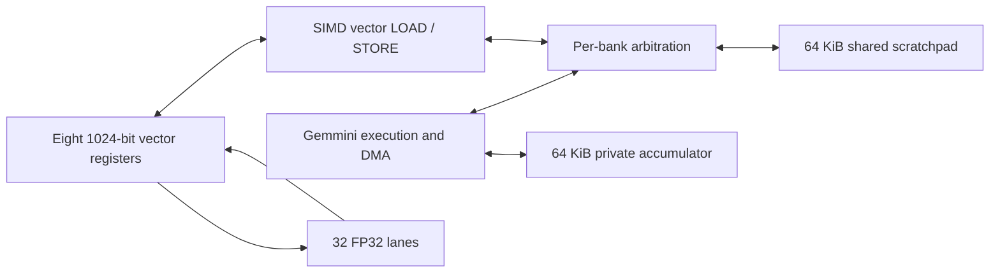

# Standalone XDNA 2 area blocks

These blocks reuse Gemmini, ActiveSPM and Constellation without instantiating a
Chipyard SoC. All configs and wrappers live in the main Chipyard repository.
They are resource proxies for area estimation, rather than implementations of
the AMD AIE instruction set.

| Block | Hardware | Target SRAM |
| --- | --- | --- |
| `AIETile` | One 32x32 INT8 Gemmini, DMA, plus 32 FP32 lanes, eight vector registers, command scoreboard and shared-scratchpad arbitration | 64 KiB scratchpad + 64 KiB accumulator = 128 KiB |
| `MemTile` | ActiveSPM, DMA, control registers, bank arbitration and request adapters | 8 x 64 KiB = 512 KiB |
| `InterconnectSwitch` | One base mesh router, its terminal router and local TileLink network interfaces | Router buffers are included in its RTL |

The complete resource target is 32 AIE tiles and 8 memory tiles: 32,768 INT8
MACs/cycle, 1,024 FP32 FMAs/cycle (2,048 FP32 FLOPs/cycle), and 8 MiB of tile
SRAM, including accumulators. Host caches are outside this budget.

The FP32 unit is instantiated by the standalone `AIETile` wrapper beside its
INT8 Gemmini. This does not convert the systolic array to floating point or
modify the Gemmini submodule. The older full-SoC `Xdna2Config` and
`Xdna2ColumnConfig` instantiate plain Gemminis and do not integrate the FP32
command interface; use `Xdna2AIETileConfig` for the compute-tile area model.

## Generate Verilog

From the repository root:

```sh
# Sources env.sh and scripts/chipyard-build-resources.sh internally.
scripts/generate-xdna2-area-rtl.sh

# Generate just one block.
scripts/generate-xdna2-area-rtl.sh aie
scripts/generate-xdna2-area-rtl.sh mem
scripts/generate-xdna2-area-rtl.sh switch

# Generate the two versions of the same MemTile.
scripts/generate-xdna2-area-rtl.sh mem mem-desc

# Optional representative locations in the same 8x5 network.
scripts/generate-xdna2-area-rtl.sh switch-edge switch-corner switch-mem
```

The script runs `make verilog` and packages the result. It does not compile a
Verilator executable, run software, or invoke Yosys/CACTI. A direct make command
for AIETile is:

```sh
source env.sh && source scripts/chipyard-build-resources.sh
make -C sims/verilator verilog \
  MODEL_PACKAGE=chipyard.xdna2 MODEL=Xdna2AreaHarness \
  CONFIG=Xdna2AIETileConfig TOP=AIETile ENABLE_YOSYS_FLOW=1
```

Use `CONFIG=Xdna2MemTileConfig TOP=MemTile` or
`CONFIG=Xdna2InterconnectSwitchConfig TOP=InterconnectSwitch` for the other blocks.
The thin `Xdna2AreaHarness` passes every functional port through to top-level IO;
it contains no traffic generator, memory responder or constant command source.

Each config has its own directory under
`sims/verilator/generated-src/chipyard.xdna2.Xdna2AreaHarness.<Config>/`:

| Artifact | Purpose |
| --- | --- |
| `gen-collateral/<Block>.sv` | Synthesizable DUT top |
| `rtl.f` | DUT and dependencies, including complete behavioral SRAM models |
| `synthesis.f` | DUT and dependencies, using SRAM blackboxes instead of flop models |
| `srams.blackboxes.v` | SRAM port declarations with the `blackbox` attribute |
| `*.top.mems.conf` | Unique SRAM types, depth, width, ports and write masks |
| `top_module_hierarchy.json` | Physical instance hierarchy under the DUT |
| `resources.json` | Instance counts, SRAM multiplicities, compute capacity and verified interconnect widths/profile |
| `*.xdna2-profile.json` | Elaborated network data/payload widths, VC count, buffer depth and native SRAM width |
| `verilog-generation.log` | Build log |

`*.top.mems.conf` lists memory **types**, not the number of physical copies.
Use the multiplicities in `resources.json` when accumulating CACTI areas.
`rtl.f` and `synthesis.f` exclude the generation harness. For Yosys, use
`synthesis.f`, the block name as the top, and the `SYNTHESIS` define. SRAM area
must then be added separately; do not add the behavioral macro models to the
same synthesis run. Small queues not extracted into SRAM macros remain in the
logic RTL.

## Interface and accounting boundaries

`AIETile.io.rocc` exposes Gemmini's RoCC command/status/response and PTW
interfaces. The unused generic RoCC memory/FPU fields remain part of the
standard bundle. `io.dma` is a **512-bit** uncached TileLink master. Gemmini's
internal DMA remains 256 bits and its existing `TLWidthWidget` converts between
that path and the 512-bit network boundary. CPU execution,
page-table walking and ReRoCC command distribution are external services, so
their hardware is not included in AIETile area.

`AIETile.io.simd` exposes a register-based SIMD command/completion interface.
The internal arithmetic core has the following properties:

| Property | Value |
| --- | --- |
| Lanes | 32; all execute the same opcode and rounding mode |
| Operand/result format | IEEE binary32, 32 bits per lane |
| Opcodes | `0`: `a*b+c` (fused), `1`: `a*b`, `2`: `a+b`, `3`: `a-b` |
| Arithmetic issue capacity | One 32-lane vector each cycle when registers and completion credits are available |
| Latency | Three cycles from input valid to output valid |
| Peak FP32 capacity | 32 FMAs/cycle = 64 FLOPs/cycle, independent of the INT8 array |
| Rounding | Modes `0..4`: nearest-even, toward-zero, down, up, nearest-max-magnitude |
| Exceptions | Per-lane 5-bit flags: invalid, divide-by-zero, overflow, underflow, inexact |
| Internal arithmetic handshake | `Valid` input/output, fixed latency; the command engine reserves completion space |

Each lane uses Rocket Chip's pipelined `MulAddRecFNPipe(2, 8, 24)`, backed by
HardFloat, followed by one output register stage. Add/subtract/multiply reuse
the FMA datapath. Signed-zero handling is retained for standalone multiply;
HardFloat handles subnormal inputs/results, special values and rounding.
Input rounding modes must be in `0..4` (there is no dynamic rounding CSR).

`FP32SimdEngine` supplies the core's operands from eight 1,024-bit vector
registers. They have three asynchronous read ports, a vector writeback port,
and a 256-bit load-write path. The **1 KiB vector register file uses flip-flops**
and is included in Yosys logic area; the SRAM budget remains 128 KiB.



The external interface is now `command: Decoupled[FP32SimdCommand]`,
`completion: Decoupled[FP32SimdCompletion]`, and `busy`. Commands contain an
8-bit user tag, kind, destination/source register indices, arithmetic opcode,
rounding mode and a 16-bit **local scratchpad byte address**:

| Kind | Operation |
| --- | --- |
| `0` / LOAD | Read a 128-byte vector from scratchpad into `destination` |
| `1` / STORE | Write vector register `sourceA` to scratchpad |
| `2` / COMPUTE | Apply the arithmetic opcode to `sourceA/B/C`, write `destination` |
| `3` | Reserved; returns an error completion |

LOAD/STORE addresses must be 128-byte aligned. Each vector transfers as four
32-byte accesses. The mapping matches Gemmini's bank-contiguous scratchpad:
address `[15:14]` selects a 16-KiB bank and `[13:5]` selects its 32-byte row.
Lane zero occupies the lowest 32 bits of the first word. FP32 values are stored
as raw IEEE bits; there is no implicit integer/float conversion. LOAD before
reading a register, since vector register contents are unspecified after reset.

The wrapper enables Gemmini's existing `use_shared_ext_mem` interface and
instantiates the same four scratchpad macros and four accumulator sub-bank
macros in `AIETileSharedMemory`. Only the scratchpad is shared with SIMD;
the accumulator remains private to Gemmini. Each macro has **one physical
read/write port**. Arbitration gives Gemmini's accepted read/write requests
priority, since that interface has no ready signal. SIMD requests wait when
their selected bank is occupied, while access to another bank can proceed.
Continuous Gemmini traffic on one bank can starve a SIMD transfer to that bank.

A scoreboard stalls read-after-write and write-after-write hazards. Independent
computations can issue every cycle. LOAD/STORE wait for arithmetic writebacks
and serialize with further commands; they do not overlap arithmetic issue.
An eight-entry completion queue and issue-credit counter preserve every
completion under backpressure. Completions return the kind, user tag, register
index, an error bit and the OR of the lanes' FP exception flags. Misaligned
LOAD/STORE, reserved command kinds and invalid compute rounding modes return
an error without modifying the register file or SRAM. `busy` remains asserted
until every accepted command's completion has been consumed.

The SIMD command port is separate from Gemmini's RoCC port. The external
controller must order overlapping data accesses: consume SIMD STORE
completion before Gemmini uses its result, and wait for Gemmini's outstanding
work/DMA to finish before SIMD LOAD consumes that data. Bank arbitration orders
physical accesses but does not resolve whole-command data dependencies.
Instruction fetch/decode, shuffle/reduction, and FP divide/square-root remain
outside this model. Peak FP32 arithmetic capacity does not imply that scratchpad
traffic can sustain three new operand vectors and one result vector each cycle.

To check this connection directly at RTL level after generation:

```sh
python3 scripts/check-xdna2-simd-rtl.py
```

This uses OSS CAD Suite's Icarus simulator for the generated SIMD engine and
shared SRAM modules. It checks four-beat vector transfers, 32-lane arithmetic
and writeback, independent issue throughput, register hazards, native SRAM
byte masks, all accumulator sub-banks, bank conflicts, completion backpressure
and invalid commands. It runs no CPU or software workload. The generated bench,
logs and `result.json` are saved under `build/xdna2-simd-rtl-check/`.

`MemTile.io.control` is the native 64-bit TileLink register port.
`io.scratchpad` is a **512-bit** slave accepting requests up to 64 bytes.
`io.dma` is a separate **512-bit** master. The scratchpad boundary preserves the
network source-ID width, remaps at most 32 concurrent requests with
`TLSourceShrinker`, converts 64-byte network beats to 32-byte native beats with
`TLWidthWidget`, fragments requests for the SRAMs, and orders responses across
banks with `TLFIFOFixer`. An eight-slot ordered SRAM ingress now implements
the FIFO execution/response contract inside ActiveSPM, allowing the fixer to
pass multiple outstanding requests instead of serializing each SRAM access.
Requests execute in order at the bank A handshake; no A queues follow that
ordering point. Two-entry bank D queues and reserved response slots decouple
SRAM execution from global response backpressure.

The ActiveSPM DMA keeps the original single-command MMIO behavior and transfers
only between configured external physical memory and its own SRAM. It has
64 external source IDs, a shared 4-KiB flop data window (64 x 64 B), and two
private 256-bit local paths with 16 tags each. Aligned bulk data is pipelined;
arbitrary alignment and a short tail use the byte-accurate compatibility
engine after the bulk path drains. Its separate 128-B realignment buffer and
all interface queues are also included in logic area. No new software channels, descriptor API,
MMIO registers, or Gemmini/Rocket interfaces are required. The address map and
eight `2048 x 256` single-port SRAM macros are unchanged.

DMA data slots, transaction metadata, queues, ordered ingress and bank
arbitration are included in Yosys logic area. The 4-KiB internal flop window
is additional storage, separate from the addressable 512-KiB SRAM. The DMA
has a 64-B/cycle ideal aligned single-direction datapath; the existing global
SRAM path remains 32 B/cycle. These are separate architectural limits, not
simultaneous measured bandwidth guarantees. NoC and bank contention still
apply. Boundary adapters belong to MemTile and must not also be counted in
the switch. Network metadata uses the DMA's actual 64-source client range.

To check the generated MemTile directly without any CPU/software workload:

```sh
python3 scripts/check-xdna2-memtile-rtl.py
```

This checks all 64 outstanding external IDs, reversed responses, tag reuse,
masked global SRAM accesses, multiple global requests under response
backpressure, concurrent DMA/global access, LOAD/STORE, aligned body plus
short tail, unaligned copies, busy START rejection, range errors, zero-length
commands and external response errors. Artifacts are saved under
`build/xdna2-memtile-rtl-check/`.

`Xdna2MemTileConfig` is the naive baseline. `Xdna2DeSCMemTileConfig` enables
two eight-entry descriptor queues, weighted admission at external DMA issue,
and per-class credits and completion feedback. Both use one ActiveSPM and one
64-slot data window. The DeSC sideband on `MemTile.io.desc` connects the decoder
and runtime in the area model. The TileLink MMIO and SRAM interfaces serve
the original inference commands and global accesses.

```sh
python3 scripts/check-xdna2-memtile-rtl.py --desc
scripts/run-xdna2-area-45nm.sh --modules mem mem-desc --output build/xdna2-desc-area-45nm
```

The DeSC RTL test applies external request backpressure, checks the 4/16 share
and the 4-to-0 transition, and verifies inference progress, decoder drain and
resume, the byte credit limit, and data movement. The area workflow maps both
variants with identical settings, verifies matching SRAM geometry, and reports
the measured MemTile logic increment per tile and across eight tiles.

`InterconnectSwitch.io.in/out` expose neighboring flit links, including credit
return and VC-free signals. `io.masters` accepts local TileLink masters;
`io.slaves` drives local TileLink slaves. The default config selects compute
position `(3,2)`, with four incoming/outgoing neighbor links and one local
Gemmini interface. The base router and terminal router are connected internally.

Switch parameters are calculated for the complete `TerminalRouter(Mesh2D(8,5))`
network, but only those two routers and their local network interfaces are
instantiated. The network uses the existing escape routing relation, five
virtual channels with **two buffer entries each**, and a **577-bit payload**:
512 data bits + 64 byte-mask bits + one corrupt bit. Routing fields, head/tail,
VC ID and valid bring the full forward interface to **608 bits**, with ten
reverse credit/VC-free bits. Each direction carries one flit per cycle. These
widths are verified from the generated top-level ports during RTL packaging.
Constellation can prune VCs
that are unreachable at a particular port. Metadata for two host cache ports
and the serial/control port preserves coherent traffic classes; it does not
instantiate host hardware. The source-ID allocation is an explicit standalone
network model and does not reproduce every adapter in the full ReRoCC SoC.

The previous 256-bit profile used five VCs with four entries each. Halving depth
keeps nominal input payload storage almost constant: `5*4*289 = 5780` bits
before, versus `5*2*577 = 5770` bits now, before pruning, routing metadata and
queue overhead. Wider crossbars and interfaces still affect logic area. Five
VCs are the minimum for the current ABCDE escape routing: protocol virtual
network IDs `0..4` require a corresponding escape channel. Reducing this count
would require changing the protocol/routing model. Output queues, unified
buffers and the 8x5 mesh topology retain their existing settings. The 512-bit
network does not widen any physical tile SRAM or the local SIMD load/store port.

`WithXdna2SwitchLocation(x,y)` selects a different location while retaining
full-network widths and routing. Provided variants are compute edge `(0,2)`,
compute corner `(0,4)`, and memory edge `(3,0)`. The latter has both a local DMA
master and a local scratchpad slave. The full mesh has 18 interior positions,
18 non-corner edge positions and 4 corners; local interfaces also differ.
Accumulate the corresponding switch variants when estimating the whole array.

## Estimate area at 45 nm

From the repository root, run:

```sh
scripts/run-xdna2-area-45nm.sh
```

The complete three-block run also writes `npu-area-table.md`,
`npu-area-table.csv` and `npu-area-table.json` in `build/xdna2-area-45nm/`,
grouped into Core ME/VE/SRAM/others, L2 SRAM/others, and NoC Switch.
Regenerate that table from an existing mapped report with:

```sh
python3 scripts/report-xdna2-area-breakdown.py
```

This analyzes `aie`, `mem`, and the interior compute `switch` separately. It
reuses the standalone RTL already generated above; missing RTL is generated
automatically. To refresh RTL from the current Scala sources first:

```sh
scripts/run-xdna2-area-45nm.sh --generate-rtl
```

The launcher sources `env.sh` and `scripts/chipyard-build-resources.sh`. Its
default tool locations are `$HOME/oss-cad-suite/bin/yosys` and
`$HOME/cacti/cacti`. CACTI's source checkout must also contain `cache.cfg`
and `tech_params/45nm.dat`. Override tool paths or the template if needed:

```sh
scripts/run-xdna2-area-45nm.sh \
  --yosys /path/to/yosys --cacti /path/to/cacti \
  --cacti-template /path/to/cache.cfg
```

The logic flow downloads the Nangate45 typical-corner Liberty from
OpenROAD-flow-scripts at commit
`23341145f0fc92a522de26d5244a4a0013818f97`, verifies its SHA-256, and saves
it under the report directory. The corner is 1.1 V / 25 C; cell areas are
in square micrometres. The downloaded Liberty retains its original notices,
and the upstream platform license is saved alongside it. A local Liberty
can be selected with `--liberty /path/to/library.lib`. Its area is assumed
to be in square micrometres; `--cell-area-scale` can change that conversion.

Yosys reads `synthesis.f` with `SYNTHESIS` defined, preserves the module
hierarchy, runs generic synthesis, maps registers with `dfflibmap`, and maps
combinational logic with `abc -liberty` and a short mapping script. Repeated modules are synthesized
once and their areas are multiplied through the hierarchy. There is no
default delay target; `--abc-delay-ps 1000` supplies an optional ABC mapping
hint. This does not establish timing closure.
Verification-only assertions/assumptions/coverage cells are removed with
`chformal -remove`, and their unused logic is cleaned before mapping. This
also handles CIRCT assertions that remain outside `SYNTHESIS` guards.

The default `--abc-quality fast` is intended for rough area exploration.
It uses the explicit ABC sequence `strash; dretime; map`, avoiding expensive
SAT-based rewriting and working with Yosys versions that removed `abc -fast`.
`--abc-quality standard` uses the more expensive default ABC optimization
script. Both modes map to the same standard-cell library; their areas can
differ because optimization quality differs.

CACTI models each physical SRAM macro using its generated depth, word width
and port count. Defaults are 45 nm ITRS HP cells/periphery, 300 K, one bank,
no ECC, and an area-only objective. `--temperature` accepts 300 through 400 K
in 10 K steps. The generated macro can contain multiple internal CACTI
subarrays; one CACTI result still represents one physical macro instance.
The flow multiplies by the physical instance count rather than by the number
of memory type definitions. Identical macro shapes reuse a cached result.

For the current tiles, this accounts for:

| Block | Physical SRAM macros |
| --- | --- |
| AIETile | 4 x `512 x 256 bit` scratchpad macros + 4 x `128 x 1024 bit` accumulator sub-bank macros |
| MemTile | 8 x `2048 x 256 bit` macros |
| Switch | No extracted SRAM macros; its short buffers are synthesized into logic |

Before accepting results, the workflow checks that all remaining logic is
mapped to Liberty cells, that its hierarchical cell-area sum agrees with
Yosys `stat`, and that the SRAM blackbox multiplicities survived synthesis.
SRAM behavioral/flop models are excluded from Yosys. Remaining small RTL
memories, such as short queues and source-ID tables, count as logic.
The AIETile report separates Gemmini, the SIMD engine and shared-memory glue.
The arithmetic core and vector register file are nested contributions already
included in the SIMD engine; the JSON labels each entry's parent to prevent
double counting. Stale AIETile RTL without the 32 FP32 lanes, vector register
file or shared-memory connection is rejected; rerun `--generate-rtl`.

Results default to `build/xdna2-area-45nm/`:

| Artifact | Contents |
| --- | --- |
| `area-report.md`, `.csv`, `.json` | Logic, SRAM and combined areas per block, with explicit units |
| `<block>/area.json` | Detailed per-block report, compute capacity, SRAM multiplicities and included Gemmini/FP32 logic contributions |
| `<block>/logic/generic.ys`, `generic.il` | Generic synthesis script and reusable checkpoint |
| `<block>/logic/synth.ys`, `abc-fast.script` | Technology-mapping scripts |
| `<block>/logic/inputs.json` | RTL content hashes, script and tool/library fingerprints |
| `<block>/logic/yosys.log`, `stat.json` | Mapping log and Yosys statistics |
| `<block>/logic/mapped.v`, `mapped.json` | Mapped hierarchical netlist |
| `cacti/<hash>/sram.cfg`, `sram.cfg.out`, `cacti.log` | Effective SRAM configuration, CSV results and log |
| `tech/source.json` | Default Liberty source revision and checksum |

The latest measurements and paper area accounting are in
the [NPU area results archive](../../../../../../docs/npu-area/README.md).

Logic area is reported in both um² and mm²; CACTI's mm² is multiplied by
the number of macro instances. Logic and SRAM are added only after unit
conversion. The combined JSON records the interconnect profile, executable/library/template hashes,
tool versions, parameters and effective configurations.

Synthesis results are cached against the RTL contents, Yosys version,
executable, Liberty and generated synthesis script. CACTI caching includes
the effective configuration, executable and 45 nm technology data. Use
`--force` to rerun tools; changing a relevant input invalidates its cache.
One workflow can write to an output directory at a time; use different output
directories for concurrent runs.
Generic synthesis has a separate checkpoint, so switching ABC mapping mode
or delay target reuses RTL preprocessing.
For example:

```sh
scripts/run-xdna2-area-45nm.sh --modules mem switch
scripts/run-xdna2-area-45nm.sh --modules switch-edge switch-corner switch-mem
scripts/run-xdna2-area-45nm.sh --force --output build/xdna2-area-45nm-repeat
```

When all three default blocks are selected, the JSON also provides a
**uniform-switch array proxy**: 32 AIETiles + 8 MemTiles + 40 copies of the
interior compute switch. This is explicitly an approximation; the actual
mesh has boundary, corner, memory and external-service interfaces. Reports
for the switch variants can be used for more detailed accounting.

The sum is an estimate of standard-cell plus SRAM-macro area. It excludes
placement whitespace, routing, clock-tree synthesis, power grid, pads and
external host infrastructure. Nangate45 logic and CACTI ITRS SRAM are
separate predictive models, rather than a single calibrated foundry PDK.
The CACTI SRAM adapter does not explicitly add byte-write-mask circuitry;
that remains a macro-model approximation. CACTI's separate off-chip DDR I/O
report is never included; only the finite SRAM CSV metrics are accepted.
